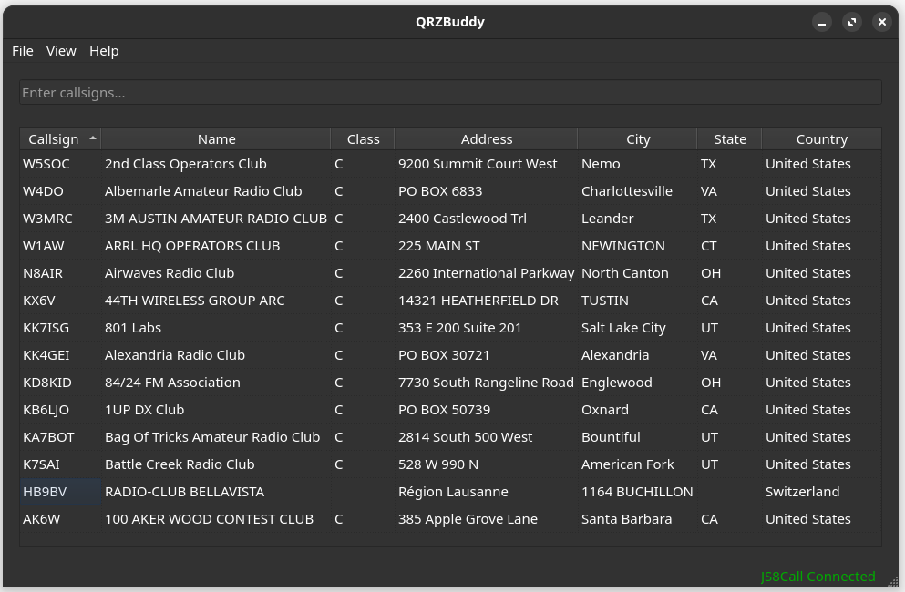
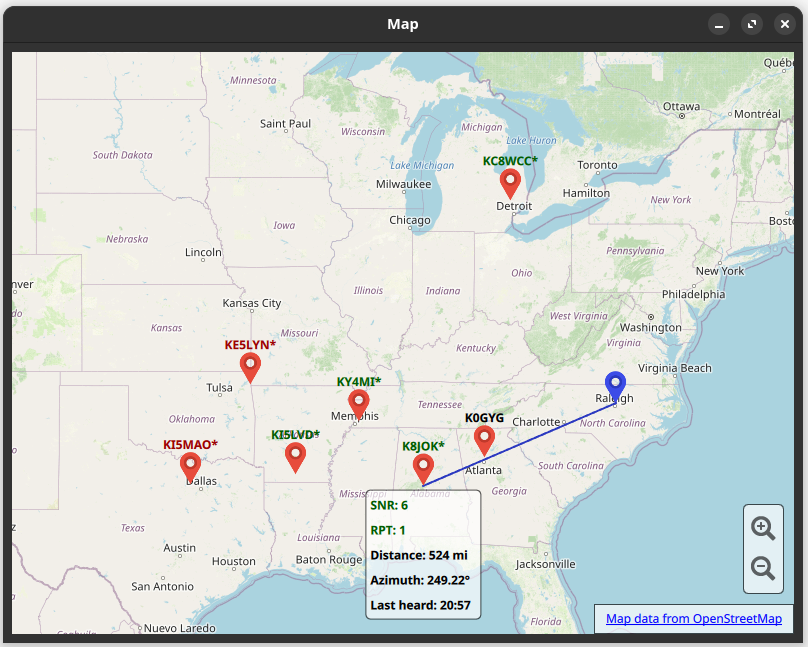
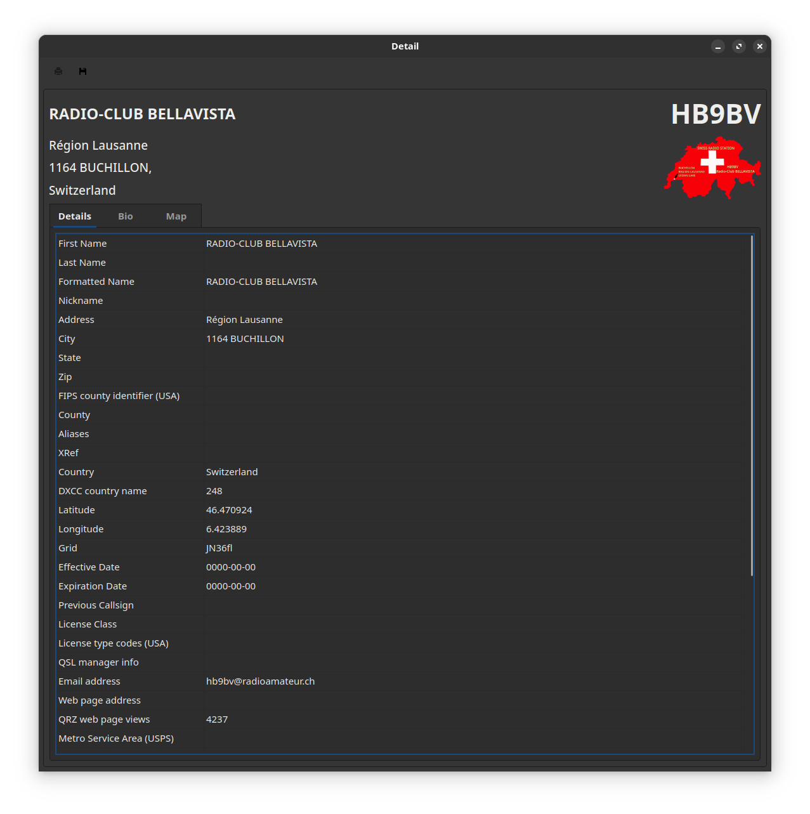
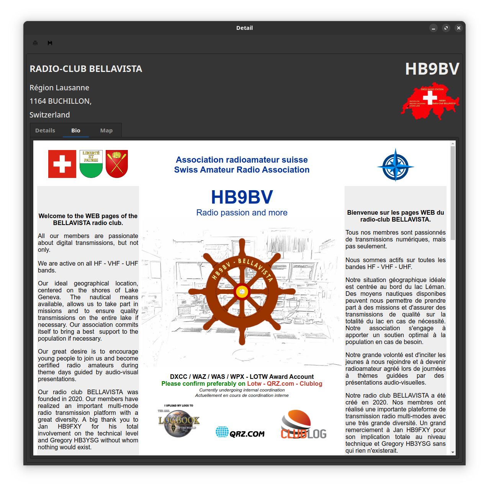
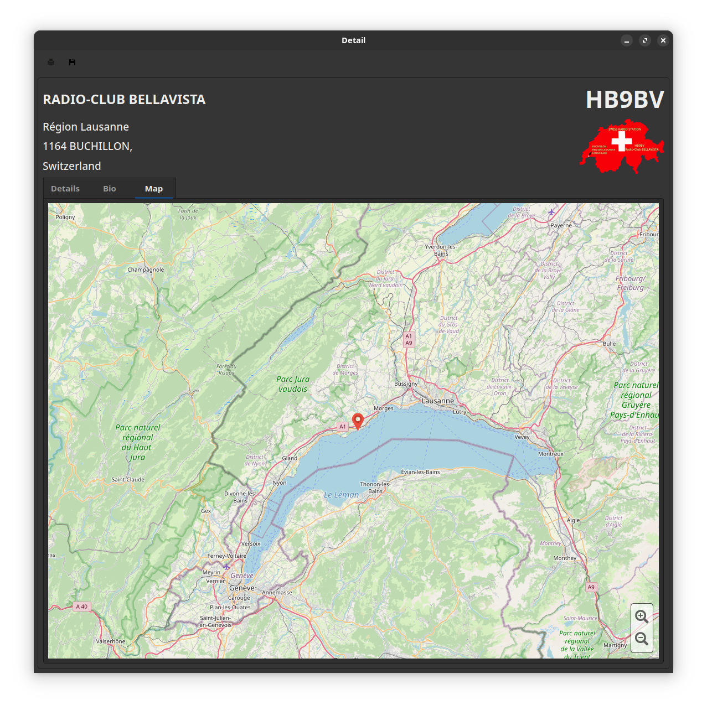
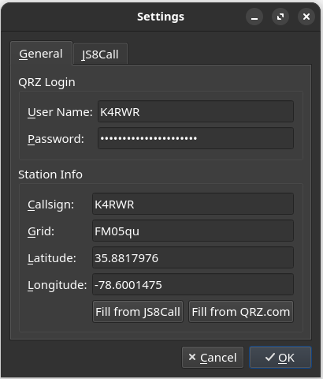
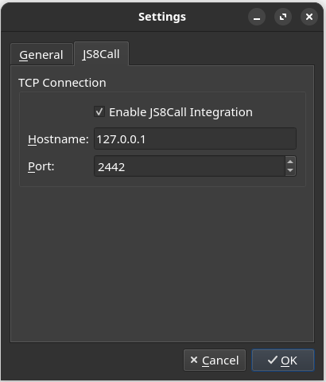

<p align="center">
  
</p>

# QRZBuddy

A desktop client for the [QRZ.com](https://www.qrz.com/) XML API, with optional [JS8Call](https://js8call.com/) integration.

## Features

- Look up callsigns manually or automatically from JS8Call activity.
- View callsign details, biographies, and geographic information.
- Explore callsigns on a map with distance and azimuth information.
- Export callsign lists as CSV, JSON, XML, or Markdown, and save individual details as PDF.

## Downloads and installation

Download the packages from [GitHub Releases](https://github.com/rruchte/qrzbuddy/releases). The multiplatform packages begin with **v1.1.0**; the existing v1.0.0 release is Windows-only.

| Platform | Package | Installation |
| --- | --- | --- |
| **Windows x64** | `qrzbuddy-windows.zip` | Extract the ZIP to a folder, then run `qrzbuddy.exe`. Keep the other extracted files alongside the executable. |
| **macOS Intel (x86_64)** | `qrzbuddy-macos-x64.dmg` | Open the DMG and copy `qrzbuddy.app` to Applications. This build is for Intel Macs; native Apple Silicon packaging is not yet available. |
| **Linux x64** | `qrzbuddy-linux-x64.AppImage` | Make the AppImage executable and launch it. For an application-menu entry and reliable GNOME dock icon, integrate the AppImage with [Gear Lever](https://flathub.org/apps/it.mijorus.gearlever). |

To launch the Linux AppImage from a terminal:

```bash
chmod +x qrzbuddy-linux-x64.AppImage
./qrzbuddy-linux-x64.AppImage
```

The AppImage is portable; Gear Lever integration is optional. The Linux package is built on Ubuntu 24.04 and may not run on distributions with older glibc versions.

**macOS security note:** The macOS application is currently unsigned and unnotarized. Gatekeeper may warn or block its first launch. On a trusted download, use macOS **System Settings → Privacy & Security → Open Anyway** if that option is offered. See [Apple's guidance](https://support.apple.com/guide/mac-help/open-a-mac-app-from-an-unidentified-developer-mh40616/mac).

## Getting started

1. Install or extract the package for your operating system and launch QRZBuddy.
2. Enter your QRZ.com callsign/username and password when prompted. **An active QRZ.com XML subscription is required** for lookups.
3. Search for a callsign to retrieve its details, biography, and location. You can save results through the **Save As** menu or save an individual detail report as PDF.
4. **Optional JS8Call integration:** Open **Settings**, enable JS8Call, and configure the JS8Call host and port. The application defaults to `127.0.0.1:2442`; JS8Call's network API must also be enabled and reachable.

The application encrypts the stored QRZ.com password with AES-256 in its local configuration. This is local credential storage, not a system keychain integration.

## Screenshots

| View | Screenshot |
| --- | --- |
| Main window |  |
| Map |  |
| Callsign details |  |
| Biography |  |
| Detail map |  |
| General settings |  |
| JS8Call settings |  |

## Release information and limitations

Releases are built for **Windows x64**, **Intel macOS**, and **Linux x64**. There is no native Apple Silicon package yet; the macOS DMG is not signed or notarized. Interactive tests are performed manually; CI checks that the packages build and are assembled.

For publishing instructions and build limitations, see [docs/releasing.md](docs/releasing.md). Release downloads include a `SHA256SUMS` file for verification.

QRZBuddy is not affiliated with QRZ.com.

*DE K4RWR 73*
